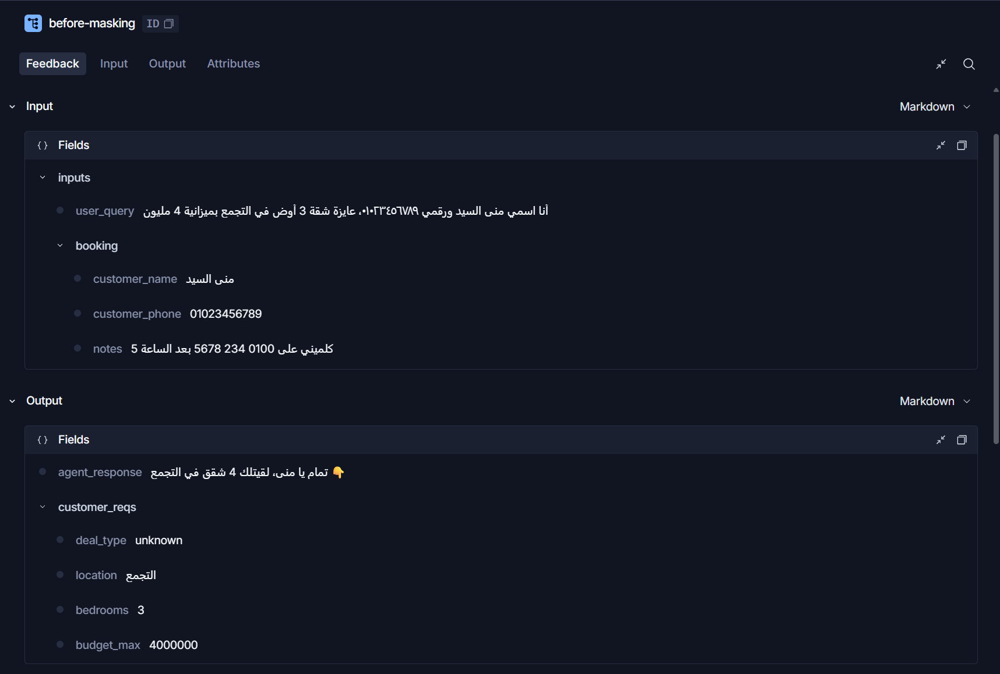
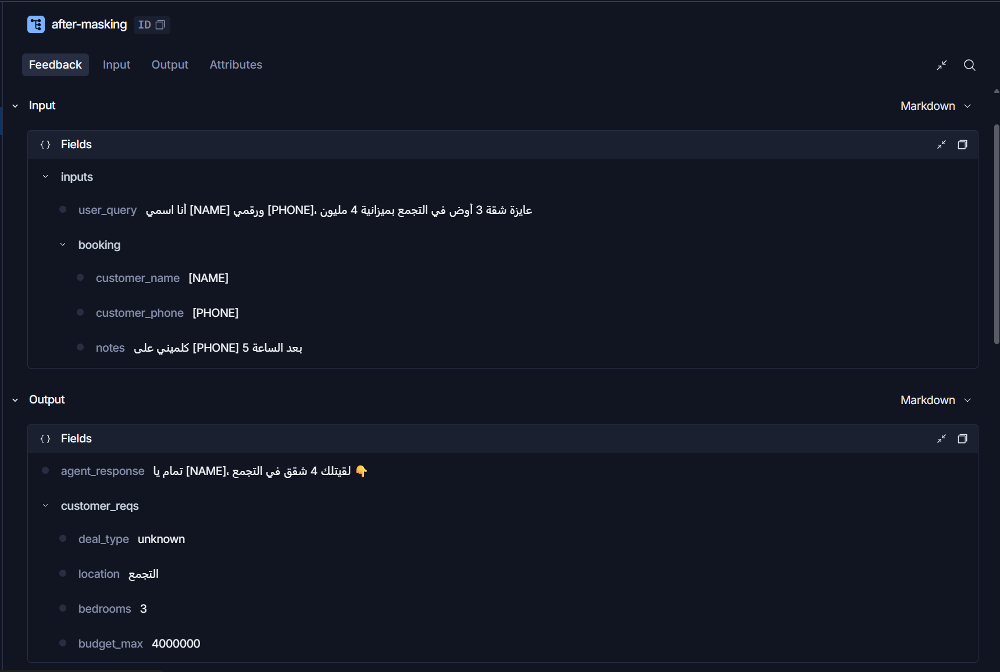

# Guardrails (Requirements #3)

This covers the parts that do **not** depend on Requirement #2 (retrieval). Grounded replies (numbers checked against the database) and poisoned listings are waiting for Requirement #2 to be finished.

| Requirement | Where | Status |
|---|---|---|
| No false claims + fix the WhatsApp message | `backend/guardrails/actions.py`, `backend/agents/final_report_node.py`, `frontend/views/chat_view.py`, `backend/agents/routing_node.py` | Done |
| Privacy (logs + LangSmith) | `backend/guardrails/pii.py`, `backend/agents/semsar_graph.py` | Done. Trace before/after in `privacy_before_after.md`, LangSmith screenshots below |
| Schema + sanity ranges | `backend/schema/state.py` (`CustomerRequirements`) | Done |
| Ask, don't guess | `backend/guardrails/clarify.py`, `backend/agents/input_node.py`, extraction prompt in `backend/services/user_input_text.py` | Done |
| Attack test (30 + 30) | `backend/guardrails/input_guard.py`, `attack_set.jsonl`, `run_attack_eval.py` | Done. Report in `attack_report.md` |

## How to run

```bash
python -m pytest tests/test_guardrails.py -q
python eval/guardrails/run_attack_eval.py          # rules only
python eval/guardrails/run_attack_eval.py --llm    # rules + LLM layer (needs a working GROQ_API_KEY)
python eval/guardrails/privacy_trace_demo.py       # with LANGSMITH_API_KEY set, sends one trace before and one after masking
```

On Windows, set `PYTHONIOENCODING=utf-8` first so Arabic output prints correctly.

## Privacy: the trace on LangSmith

The same trace was sent twice to the `SmartSemsar-privacy-demo` project (by `privacy_trace_demo.py`).

Before masking: the name and phone number are visible.



After masking: the name is `[NAME]` and the phone number is `[PHONE]`. Location, bedrooms and budget are unchanged.



## Attack test results (rules only)

- Main set (30 + 30): **30/30 attacks blocked, 0/30 normal requests wrongly blocked**. This set was written together with the rules, so this number overstates how well they generalize.
- Holdout set (new sentences, never used to tune the rules): **only 2/11 attacks blocked**, 0/11 normal requests wrongly blocked.
  So rules alone are not enough against new phrasings. That is why there is a second, LLM-based layer (`--llm`),
  but it is **not tested yet**: the available Groq key returned 401 (Invalid API Key). Once a working key is available, run `--llm`
  and add both numbers to the report.
- Recommended before the final report: someone on the team writes 30 new attacks without looking at the rules, and the report uses that number.
